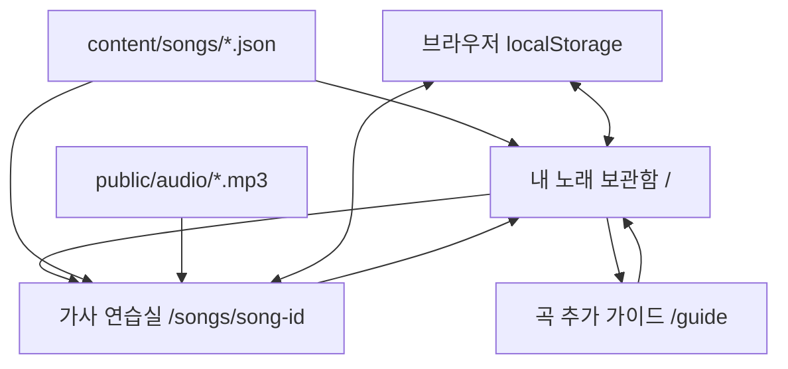

> **정적 전환 이후 기준:** 현재 설정/API 제거·한 곡 정적 빌드·곡 자료 Git 포함·곡 이름 커밋 규칙은 [24번 기록](24_정적사이트_곡교체_커밋규칙.md)을 우선합니다. 아래 내용은 이전 단계의 기록입니다.

> **이력 문서 안내 (2026-10-12):** 이 문서의 구현 상태는 작성 당시 기록입니다. 현재 화면·기능·검증 상태는 [22번 운영 기록](22_현재상태_운영과검증.md)과 [현재 README](../README.md)를 우선합니다.

# 02. IA / 화면설계 / 반응형 와이어프레임

## 1. 정보 구조



### 경로 및 메타데이터

| URL | 주요 파일 | 주요 역할 | 표시 조건 |
| --- | --- | --- | --- |
| `/` | `app/page.tsx` | 로컬 곡 목록 / 검색 / 즐겨찾기 / 진행 비율 | 항상 |
| `/songs/[slug]` | `app/songs/[slug]/page.tsx` | 가사·음원 연습 기능 | JSON의 유효한 `id` |
| `/guide` | `app/guide/page.tsx` | 곡 데이터 추가 안내 | 항상 |
| 존재하지 않는 경로 | `app/not-found.tsx` | '곡을 찾을 수 없음' | 경로/slug 오류 |

## 2. 공통 디자인 프레임

```text
┌───────────────┬────────────────────────────────────────────────────────┐
│  가사봄 로고   │ 상단 경로탐색                            PRIVATE LOCAL │
│               ├────────────────────────────────────────────────────────┤
│  보관함       │                                                        │
│  가사 연습실   │      콘텐츠 영역(최대 폭, 여백, 카드 레이아웃)          │
│  곡 추가 가이드│                                                        │
│               │                                                        │
│  연습 응원    │                                                        │
│               │                                                        │
│  LOCAL ONLY   │                                                        │
└───────────────┴────────────────────────────────────────────────────────┘
```

- 사이드바: 데스크톱 고정(기본 242px), 작은 노트북 208px.
- 헤더: 72px, 현재 화면 경로와 로컬 상태 안내.
- 콘텐츠 패딩: 데스크톱 56px, 중간 화면 35px, 모바일 20px.
- 배경: 아주 밝은 웜그레이, 카드: 흰색, 강조: 잔잔한 보라색.
- 모바일 ≤ 760px: 사이드바 대신 상단의 축소 로고·아이콘 메뉴.

## 3. 화면 01: 보관함 `/`

```text
┌─────────────────────────────────────────────────────────────────┐
│ ✳ YOUR LITTLE MUSIC WORLD                                      │
│ ┌─────────────────────────────────────────────────────────────┐ │
│ │ 일본어를 몰라도...                                          │ │
│ │ 좋아하는 노래를 나의 언어로 부르는 시간.     [레코드 이미지] │ │
│ │ [지금 연습 시작] [사용 방법 보기]                            │ │
│ └─────────────────────────────────────────────────────────────┘ │
│ ┌───────────────┬─────────────────────┬───────────────────────┐ │
│ │ 보관함의 노래 │ 외웠다고 체크한 가사 │ 즐겨찾는 노래         │ │
│ └───────────────┴─────────────────────┴───────────────────────┘ │
│  MY COLLECTION                                                 │
│  나의 노래 보관함                               [+ 곡 추가 방법] │
│  [모든 곡] [즐겨찾기]                 [ 노래, 가수, 태그 검색 ] │
│  ┌─────────────┐ ┌─────────────┐ ┌─────────────┐              │
│  │   COVER     │ │   COVER     │ │   COVER     │              │
│  │            ♥│ │            ♥│ │            ♥│              │
│  │ 노래 제목   │ │ 노래 제목   │ │ 노래 제목   │              │
│  │ 가수 / 진행 │ │ 가수 / 진행 │ │ 가수 / 진행 │              │
│  └─────────────┘ └─────────────┘ └─────────────┘              │
└─────────────────────────────────────────────────────────────────┘
```

### 제어·상태

- **곡 카드 클릭**: `/songs/{id}` 이동.
- **하트 클릭**: 이동 없이 즐겨찾기 토글.
- **검색창 입력**: 제목/일본어 제목/가수/장르/태그를 동시에 필터.
- **즐겨찾기 필터**: 즐겨찾는 곡만 표시.
- **진행 비율**: `해당 song.id에서 체크된 유효 line.id / 전체 줄 수`.
- **곡이 아예 없음**: 곡 추가 가이드 링크 제공.
- **검색 결과 없음**: 필터/검색어 수정 안내.

## 4. 화면 02: 가사 연습실 `/songs/[slug]`

```text
┌────────────────────────────────────────────────────────────────────┐
│ ← 보관함으로                                                       │
│ ┌──────────────┐  NOW PRACTICING                                   │
│ │              │  밤하늘의 편지                      ◯ 45%           │
│ │   앨범 아트  │  夜空の手紙                                        │
│ │              │  가수 / 장르 / 난이도                               │
│ └──────────────┘  [노래 재생] [즐겨찾기]                           │
│                                                                    │
│  가사를 보며 따라 불러요                           [집중 모드]     │
│ ┌────────────────────────────────────┬─────────────────────────┐  │
│ │ LYRICS                    SYNC ON │   YOUR PRACTICE GUIDE   │  │
│ │ 표시 항목 [원문] [발음] [뜻]       │   01 읽기              │  │
│ │                        [암기 도전]│   02 느리게 부르기      │  │
│ │                                    │   03 한 줄 암기         │  │
│ │     [01]   静かな夜に...          │─────────────────────────│  │
│ │     [✓]    시즈카나 요루니...     │  A–B 구간 반복          │  │
│ │            조용한 밤에...       ↻ │  [A]───[B]             │  │
│ │                                    │  [A설정][B설정][초기화] │  │
│ │     [02]   遠い街の...            │─────────────────────────│  │
│ │     [ ]    토오이 마치노...       │  키보드 단축키          │  │
│ │            먼 거리의...         ↻ │                         │  │
│ │                                    │                         │  │
│ │       (줄별 가사 스크롤)           │                         │  │
│ │   5 / 12줄 익힘 [자동 스크롤]      │                         │  │
│ └────────────────────────────────────┴─────────────────────────┘  │
│ ╔═══════════════ 하단 고정 플레이어 ═══════════════════════════╗  │
│ ║ 곡 정보      ⏮  -5  ▶  +5  ⏭        속도 1.0x  음량         ║  │
│ ║               1:18 ━━━●━━━━━━━━ 3:46                      ║  │
│ ╚══════════════════════════════════════════════════════════════╝  │
└────────────────────────────────────────────────────────────────────┘
```

### 핵심 영역

1. **곡 헤더**: 제목/일본어 제목/가수/곡 설명/태그/학습률.
2. **가사 표시 도구모음**: 원문·한글 발음·번역 표시/숨김.
3. **암기 도전**: 발음과 뜻을 가린 상태, 줄 클릭 시 확인.
4. **가사 행**: 순번, 학습 체크, 3단 가사, 반복 버튼.
5. **연습 도움 패널**: 처음 사용자 안내.
6. **A–B 구간 반복 도구**: 재생 위치를 직접 두 번 지정.
7. **하단 플레이어**: 재생/탐색/속도/음량.

### 가사 클릭 정책

| 조건 | 동작 |
| --- | --- |
| 일반 모드 + 타임코드 있음 + MP3 있음 | 그 줄 시작 시점으로 이동 |
| 일반 모드 + 타임코드 없음 또는 MP3 없음 | 그 줄을 수동 선택(재생은 하지 않음) |
| 암기 모드 | 위 동작에 더해 그 줄의 발음·뜻 공개/재가림 |
| 체크 버튼 | 해당 줄의 학습 완료 상태만 변경; 가사 클릭과 분리 |
| 반복 버튼 | MP3·타임코드 모두 준비됐을 때만 활성화 |

### 줄 자동 강조 기준

현재 재생 시각 `t`에 대해, `[start, end)` 구간을 포함하는 줄을 활성으로 처리. 빈 구간(gap)에 있으면 마지막으로 시작한 줄을 유지. 아직 어떤 줄도 시작하지 않았으면 첫 줄을 기본 표시. 타임코드가 없을 때는 사용자가 직접 누른 줄을 강조.

## 5. 화면 03: 곡 추가 가이드 `/guide`

```text
┌───────────────────────────────────────────────────────────┐
│ 좋아하는 노래, 내 연습실에 담기.                           │
│                                                           │
│  01  MP3를 public/audio/ 에 복사                           │
│  02  content/songs/ 에 가사 JSON 파일 작성                 │
│  03  브라우저 새로고침                                     │
│                                                           │
│  JSON 작성 예시                         [파일 체크리스트]    │
│  {                                 ...  [알아두세요]       │
│    "id": "...",                                           │
│    "lines": [...]                                         │
│  }                                                        │
│                                                           │
│  타임코드 선택사항 / TXT 변환 방식 안내                    │
└───────────────────────────────────────────────────────────┘
```

## 6. 반응형 우선순위

| 폭 | 규칙 |
| --- | --- |
| 데스크톱 1260px 이상 | 242px 사이드바, 앨범 카드 3열, 연습 가사+도움 패널 |
| 중간 1050~1259px | 콘텐츠 여백 축소, 연습 도움패널 일부 2열 재배치 |
| 태블릿 761~1049px | 카드/연습 레이아웃 단순화, 플레이어 폭 최적화 |
| 모바일 760px 이하 | 상단 아이콘 메뉴, 보관함 2열, 연습 도움패널 숨김, 플레이어 전체 폭 |
| 작은 모바일 480px 이하 | 제목/조작 밀도 축소, 노래 카드 2열, 가사 글자 최소 크기 유지 |

## 7. 접근성·상태 설계

- 버튼은 실제 `<button>`, 곡 이동은 `<a>`/Next Link.
- 아이콘만 있는 버튼에 `aria-label` 지정.
- 켜짐/꺼짐 버튼에 `aria-pressed` 사용.
- 진행바/음량은 접근 가능한 range input.
- 동기화 불가/MP3 누락은 명시적 안내로 알려줌.
- 경고 메시지에 텍스트 포함. 색상만으로 구분하지 않음.
- reduce-motion 환경은 애니메이션·부드러운 스크롤 억제.
- 키보드 포커스 시 보이는 외곽선 유지.
