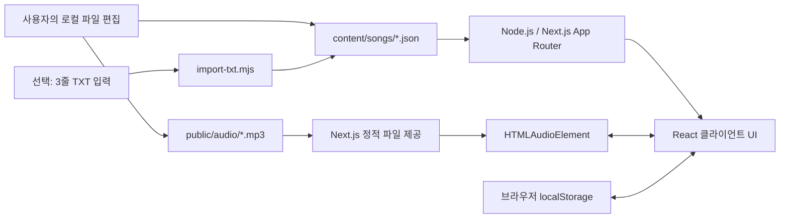
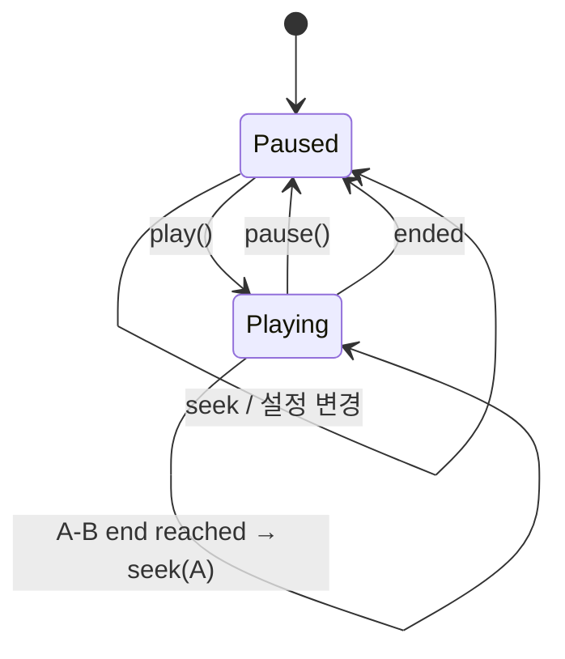

> **이력 문서 안내 (2026-10-12):** 이 문서의 구현 상태는 작성 당시 기록입니다. 현재 화면·기능·검증 상태는 [22번 운영 기록](22_현재상태_운영과검증.md)과 [현재 README](../README.md)를 우선합니다.

# 04. 기술 아키텍처 / 파일 기반 데이터 설계

## 1. 아키텍처 개요



**요지:** 데이터베이스 대신 파일 시스템에 있는 JSON이 **곡·가사의 원본(Source of Truth)**이다. 브라우저 저장소는 즐겨찾기/연습 기록에만 사용하며, 음원/가사 원본을 복제하거나 서버로 업로드하지 않는다.

## 2. 기술 선정 근거

| 기술 | 용도 | 이유 |
| --- | --- | --- |
| React 19 | 반응형 UI/상태 | 화면 표시/동작 분리 |
| Next.js 16 App Router | 로컬 HTTP 서버, 페이지 라우팅 | 파일 시스템의 JSON을 서버에서 읽고 MP3 제공 |
| TypeScript | Song/LyricLine 타입 | 필수 필드 누락 방지 |
| Native HTMLAudioElement | MP3 재생/탐색/속도 | 외부 플레이어/스트리밍 SDK 불필요 |
| Node.js `fs/promises` | JSON 읽기 | DB 대신 로컬 파일 사용 |
| Browser localStorage | 즐겨찾기·외운 줄 체크 | 1인·단일 브라우저에 충분 |
| CSS | 반응형/앨범아트 | UI 라이브러리·외부 이미지 의존성 최소화 |
| Plain Node scripts (`.mjs`) | JSON 검증/TXT 변환 | 별도 변환 서버가 필요 없음 |

## 3. Server / Client 책임 분리

### 서버 코드 (파일 읽기)

- `app/page.tsx`: `getAllSongs()` 호출 → `HomeScreen`에 데이터 전달.
- `app/songs/[slug]/page.tsx`: `getSongById(slug)` 호출 → 연습실에 곡 데이터 전달.
- `app/guide/page.tsx`: 도움말 표시.
- `lib/songs.ts`: `node:fs/promises`와 `node:path`로 JSON 로드.

**보안 경계:** 노래 ID에 허용 문자(`a-z`, `0-9`, `-`) 규칙을 적용하고, 임의의 사용자 URL이 파일 경로를 건드릴 수 없도록 제한한다.

### 클라이언트 코드 (브라우저 기능)

- `components/HomeScreen.tsx`: 검색어/즐겨찾기 상태.
- `components/SongPractice.tsx`: 재생 상태/속도/음량/동기화/암기/반복.
- `lib/storage.ts`: localStorage 접근. 클라이언트 코드에서만 접근하고 마운트 후 로드.

**주의:** `fs` 모듈을 클라이언트 컴포넌트에서 import하지 않는다. `window.localStorage`를 서버 컴포넌트에서 접근하지 않는다.

## 4. 파일 경로 계약

```text
content/songs/your-song-id.json   ← JSON 원본 데이터
public/audio/your-song-id.mp3      ← MP3 원본 파일
JSON.audioSrc = "/audio/your-song-id.mp3"
```

Next.js는 `public/`에 있는 파일을 사이트 루트 경로로 서빙한다. 따라서 URL에 `/public/`을 포함하지 않는다.

`coverSrc`를 사용하려면 `public/covers/cover.jpg`에 이미지를 넣고 `"coverSrc": "/covers/cover.jpg"`로 참조한다. 미작성 시 테마별 CSS 아트워크가 사용된다.

## 5. 기본 데이터 엔터티

```typescript
type LyricLine = {
  id: string;
  ja: string;
  koPronunciation: string;
  koTranslation: string;
  section?: string;
  start?: number; // 초
  end?: number;   // 초
};

type Song = {
  id: string;
  title: string;
  titleJa?: string;
  artist: string;
  description?: string;
  genre?: string;
  difficulty: "쉬움" | "보통" | "어려움";
  coverTheme: "violet" | "mint" | "peach" | "blue" | "midnight";
  coverSrc?: string;
  audioSrc: string; // MP3 없음 = ""
  tags: string[];
  lines: LyricLine[];
};
```

추가 세부 사항은 [05_데이터_작성_가이드.md](05_데이터_작성_가이드.md).

## 6. 곡 데이터 읽기 정책

- `content/songs/` 폴더의 `.json`을 읽는다.
- `_`로 시작하는 파일은 읽지 않는다(예: `_TEMPLATE.json`).
- JSON 파일 이름이 곡 `id`와 일치해야 한다.
- 서버 요청마다 파일 시스템을 읽어 변경 내용을 반영하도록 주요 페이지에서 `dynamic = "force-dynamic"` 사용.
- 화면을 새로고침하면 수정한 JSON 데이터를 다시 읽는다. 브라우저·개발 서버의 캐시/워처 상황에 따라 재시작이 필요할 수 있다.
- 파일 형식 유효성은 `npm run validate:data` 스크립트가 정식 판정한다. 런타임에서는 필수 기본 필드만 빠르게 확인한다.

## 7. 저장소 구조

**localStorage 키:** `gasabom:practice:v1`

```json
{
  "favorites": ["yoru-no-tegami"],
  "learned": {
    "yoru-no-tegami": ["line-01", "line-03"]
  },
  "options": {
    "showJapanese": true,
    "showPronunciation": true,
    "showTranslation": true,
    "autoScroll": true
  }
}
```

### 데이터 무결성 원칙

- 곡 순서나 제목을 바꿔도 `song.id`는 유지하면 즐겨찾기/학습 기록이 보존된다.
- 가사의 일본어 텍스트를 고치더라도 `line.id`가 유지되면 체크 기록은 보존된다.
- 줄을 삭제한 경우 저장소에 이전 ID가 남아 있어도 화면 진행률 계산에서는 무시한다.
- 브라우저의 저장 데이터는 사용자에 의해 삭제될 수 있으므로 **영구적인 백업으로 간주하지 않는다**.
- 음원 볼륨/재생속도/AB 설정은 이번 예제에서 영구 저장하지 않는 **현재 페이지 상태**이다.

## 8. 오디오 이벤트/동기화 모델



- `audio.currentTime`: 음원의 실제 재생 시점(초).
- `audio.duration`: 파일 로드 후 파악되는 전체 길이(초).
- `audio.playbackRate`: 선택한 재생속도.
- `audio.preservesPitch = true`: 가능한 브라우저에서 재생속도 변경 시 피치 유지 요청.
- 재생 중 `requestAnimationFrame`에서 짧은 A–B 루프 경계 확인. 실제 상태 표시 업데이트는 과다 렌더링 방지를 위해 약 90ms 간격.
- `timeupdate`, `play`, `pause`, `ended`, `error`, `loadedmetadata` 이벤트도 처리.

## 9. 개인정보·저작권·네트워크

- 기본 실행 명령이 `127.0.0.1`만 바인딩하도록 함.
- 유저의 MP3와 가사는 클라우드로 보내지 않는다.
- 외부 추적/분석 라이브러리나 번역 서비스를 포함하지 않는다.
- **중요:** `npm install`은 패키지를 인터넷에서 받으며, Next.js 개발 도구의 내부 네트워크 동작은 본 앱의 데이터 수집 목적과 별개다. 인터넷과 완전히 차단된 재설치를 하려면 npm 패키지를 미리 캐시/보관해야 한다.
- 사용자는 음원의 사용권·저작권을 직접 확인하고, 정당한 범위의 개인 학습 파일만 이용해야 한다.

## 10. 성능과 확장 한계

- 수십~수백 곡 규모의 작은 개인 보관함은 JSON 조회로도 충분한 경우가 많다.
- 현재 홈은 모든 곡의 가사 배열을 함께 읽는다. 수천 곡/수십만 줄로 커지면 **보관함 인덱스와 곡 상세 가사 로드를 분리**하는 개선이 필요하다.
- 앱은 다중 사용자 동시 수정이나 네트워크 파일 동기화를 고려하지 않는다.
- 24시간 자동 작동·클라우드 배포는 요구하지 않는다. 연습할 때만 로컬 서버를 켜면 된다.
